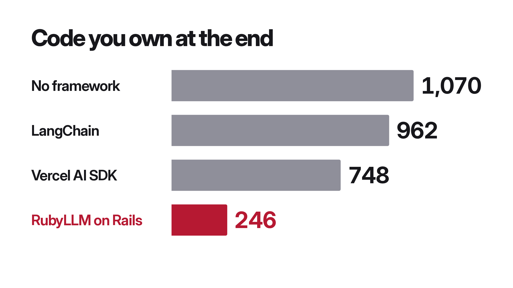

You've heard it this year. Maybe you've said it yourself: "You don't need frameworks anymore. Just let the agent write it. Why would you depend on somebody else's gem?"

And it's spreading. My friend [Andrzej Krzywda](https://x.com/andrzejkrzywda/status/2112865294075265072) goes to every Ruby conference and talks to everybody, and a few weeks ago he wrote that 40% of the devs he meets are trying to reinvent [RubyLLM](https://rubyllm.com), my AI framework. One person's impression, sure. But you can feel it in the air.

I think it's bullshit, and I wanted to prove it, not just say it.

## Same Agent, Same App, Four Times

So I took a coding agent, Codex on GPT-6 Astra, a really good one, and gave it the same app to build four times: with RubyLLM on Rails, with LangChain and LangGraph, with the Vercel AI SDK, and with no framework at all, just plain Ruby with no AI libraries or provider SDKs. Each framework got its own official agent skill where one exists.

The app is a real chat app, built over eleven steps, each a new agent session on the same project: streaming, conversations, cancel, cost tracking, a second provider you can switch to mid-conversation, fallbacks, surviving a restart, tool approvals, files and a code sandbox, MCP, and then Gemini, Azure and Bedrock. After each step, a test suite the agent never sees drives the app in a real browser and reruns every check on every provider, 198 checks by the end. The providers are fakes built from real recorded responses, so every stack gets the same replies, errors and stalls.

Without a framework, the agent got there. Streaming on Bedrock? Done. Tools on Gemini? No problem. Honestly, it's really good at it.

But every line it writes is a line you own, for every feature on every provider, and every provider streams, calls tools, caches and counts tokens differently. To stream from Bedrock, the agent signed every request by hand with AWS Signature Version 4, then decoded Amazon's binary event stream frame by frame, checking the CRCs. 93 lines. It works, and I never want to look at it again. With RubyLLM, the same agent wrote four lines of configuration, and Bedrock got approvals, fallbacks, caching and cancel, everything the app already did.

So, case closed? Frameworks matter? Not quite.

## My Framework Lost at First

In my first runs, RubyLLM was installed and my own skill was loaded, and the agent still:

- wrote its own price table, with a wrong price, instead of reading `chat.cost`,
- monkey-patched the gem to count usage, when RubyLLM already sends an event for every call,
- rebuilt HTTP cancellation by hand, next to `chat.cancel`,
- read 280,000 tokens of my source code to find things the guides already said.

That's the worst of both worlds: the dependency, plus the agent's own code on top of it.

The agent isn't dumb. It takes the easiest path it can see, and when it can't see the framework's way, it writes its own. So frameworks matter only if agents can use them well. That matters more every month, because more and more of the code that uses RubyLLM is written by Claude Code, Codex and Cursor. So this cycle I treated coding agents as RubyLLM's main users, and turned the benchmark into a loop: agents build the app on RubyLLM's main branch, I read the transcripts for where they stumble or write code they shouldn't need, I fix the cause where it lives (the gem, a generator, the docs or the skill), and I run it again. I'm 28 rounds in, and here's what I learned.

## 1. Fix the Library, Not the Prompt

My instinct was to tune the skill, the instructions file agents load. I tried several versions, then ran a control: RubyLLM's old, unchanged skill on the fixed library. It did about as well as my tuned one. Most of the improvement, from 0 of 5 clean first attempts to 8 of 8, came from fixing RubyLLM itself, because what the agents tripped on were real bugs and bad defaults:

- A message sent right after Stop was lost. The agent only saw a failing test's name, so it rebuilt cancellation by hand. ([#1504](https://github.com/crmne/ruby_llm/pull/1504))
- A stale cancel flag stopped the next reply, and finished chats looked like running ones, so agents wrote boot scripts that "cleaned up" by cancelling every chat. ([#1509](https://github.com/crmne/ruby_llm/pull/1509))
- An agent class that named a provider for its default model refused every other provider's model. ([#1507](https://github.com/crmne/ruby_llm/pull/1507))

No prompt fixes a library that does the wrong thing. If agents keep working around something, it's probably broken.

## 2. A Default That Looks Right Is a Trap

Some of those bad defaults looked perfectly reasonable. The sandbox generator suggested adding `file_store` next to `code_execution`. In Rails a bare `file_store` means Active Storage, so the sandboxed code started in an empty folder and couldn't see the uploaded files. Every agent that followed the suggestion failed the same two checks, and the ones that ignored it passed.

Agents copy what they're shown, exactly, so every example, generator message and default has to be right as written.

## 3. When Every Agent Writes the Same Line, the Library Should Write It

The flip side: when every agent adds the same thing, it belongs in the library. Every RubyLLM attempt failed the "one huge tool result" check on its first try, and every one fixed it with the same line, a context budget. That line is now a global setting, and the install generator writes it for new apps. ([#1562](https://github.com/crmne/ruby_llm/pull/1562))

## 4. Put Facts Where the Agent Is Writing

In run after run, agents grepped the gem for the same fact: does `anthropic_api_base` include `/v1/messages`? Once the docs covered it, I took it out of the skill, and agents went straight back to grepping the source in 5 of 8 runs. Nobody opens a guide halfway through writing an initializer.

So the fact went back into the skill, and RubyLLM now refuses a base URL with an endpoint path, with an error that says what it expects. ([#1566](https://github.com/crmne/ruby_llm/pull/1566)) An error message is documentation the agent can't skip.

## 5. Point Agents at the Guides, Not the Source

That grepping started with my own advice. The original skill said to start with the installed gem, and agents took it literally: dozens of source reads in the first minutes, and one command that printed a megabyte. A guide is much cheaper to read than `chat.rb`.

Now the skill points at the guide for each feature ([#1480](https://github.com/crmne/ruby_llm/pull/1480)), every docs page also comes as Markdown, there's an `llms.txt`, and the skill is a short core with references loaded only when needed ([#1618](https://github.com/crmne/ruby_llm/pull/1618)). It ships inside the gem, so it always matches the installed version.

## 6. Agents Believe the Most Confident Source

Even pointed at the right place, an agent can be talked out of it. In the first pilot, both RubyLLM attempts knew RubyLLM priced calls, and both overruled it, because another skill they had loaded, Claude Code's bundled API skill, listed a cache-read price twice as high as Anthropic's own pricing page. RubyLLM was right. All four attempts in that pilot, on every stack, failed the cost checks on exactly that number.

So RubyLLM's skill now says it plainly: read cost from RubyLLM, and never copy prices from another skill, an article or memory.

## 7. Fewer Names, Fewer Wrong Guesses

Every public name is a guess an agent can get wrong. RubyLLM had seven methods for asking what a chat was waiting on and for saying no. 2.2 has two lists, `pending_questions` and `pending_tasks`, and one way to say no, `decline`. Every public method is listed in `api.txt`, and CI fails when it changes without review. ([#1549](https://github.com/crmne/ruby_llm/pull/1549))

## 8. Agents Can't Tell a Broken Test from a Broken Library

Clear failures matter just as much. When a check fails and the agent only sees its name, it can't tell whether its own code, the library or the check is wrong. More than once, a bug in my own test suite sent agents off replacing perfectly good framework code. So I fix the suite, and I make the library's errors loud and specific, so the agent knows where the problem is.

## What It Did to the Numbers

Here's the code the agent wrote by hand and still owned after the eleven steps, averaged over each stack's attempts on the final suite. Tests, generated code and installed packages don't count.

| Stack | Hand-written app code |
| --- | ---: |
| Rails + RubyLLM | 246 |
| Vercel AI SDK | 748 |
| LangChain | 962 |
| No framework | 1,070 |

And the code that speaks each provider's own format: zero lines with RubyLLM, for every provider, and up to 97 per provider without a framework.

Of course, I tuned against this benchmark on purpose. So I kept a second task out of the loop entirely: a support desk with documents, a sandbox, MCP tools and approvals, then five change requests. No agent saw it while I tuned anything. With RubyLLM the agent wrote about 420 lines of app code; with no framework, 867. In the latest RubyLLM run, every step passed on the first try.

## What It Didn't Fix: The Bill

I expected less code to mean fewer tokens. It didn't. On the held-out task with Codex, the RubyLLM run cost $12.34 and the no-framework run $12.78. On the chat app, the final RubyLLM runs cost about $21 each, the no-framework runs between $17 and $24. With Claude Opus on the held-out task, RubyLLM came out at 1,088 lines against 2,969, but cost $19 against $11.

The transcripts show why: an agent on the generator path made about three times as many model calls as one writing everything itself, and read over four times as much tool output. It reads the code it didn't write, then tests all of it by hand. That's what I'm working on next: telling the agent what the generators gave it, so it doesn't have to read it all.

## The Caveats

- One kind of app. Chat apps with tools, files and providers are what RubyLLM is built for, and I wrote the benchmark. I checked every step against what the other frameworks' own docs say they support, but a different kind of app could rank them differently.
- A handful of attempts per stack, one model at a time. The spread between attempts is real.
- Costs are tokens at list price, not money spent.
- The suite changed during the runs, each time to fix a fault in a check or the harness, and I re-scored every attempt it affected.

## Why It Matters

Same bill, then, but a quarter of the code, and the code is what stays. The agent leaves when it's done, and the responsibility for what it wrote stays with you. Providers change every week, and a thousand lines of hand-rolled provider code is a thousand lines you fix forever. With a framework, someone else fixes it once, and everyone gets the fix with `bundle update`.

That only works if the agent actually uses the framework. Frameworks matter, if your agent knows how to use them, and making sure it does is now as much a part of RubyLLM's design as any feature.

Everything from this loop shipped in [RubyLLM 2.2](https://paolino.me/rubyllm-2-2/), which I released on stage at SF Ruby, where I first told this story.
